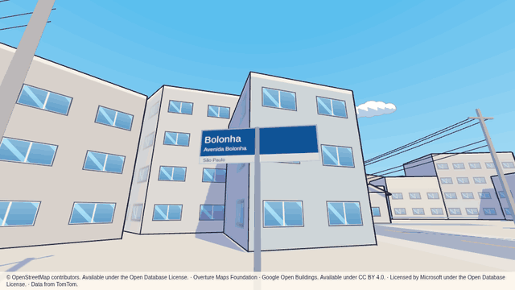
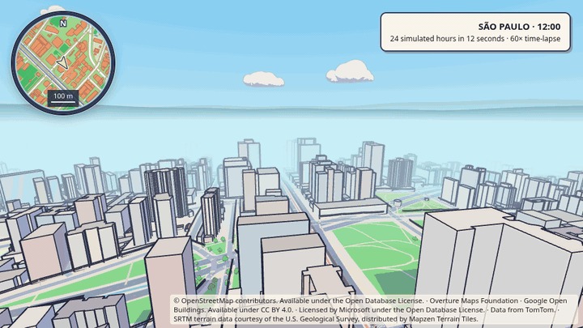

# GeoToon

Type an address and walk the streets around it in a cel-shaded 3D map. GeoToon looks the
address up with the Photon geocoder, loads buildings, streets, land use, water and trees
for a 2 km radius from Overture Maps into PostGIS, and draws them in the browser with
Three.js in an anime street style: pastel walls with windows, clay-tile roofs, ink
contours, crisp blue shadows, utility poles and a painted sky.

The initial view opens at **Av. Paulista, 1578 — MASP, São Paulo**. Choose **New address**
to explore somewhere else; shared coordinates still override the initial location.
Where SRTM elevations are available, the landscape has geographical relief: streets,
parks, buildings, trees and signs follow the terrain, and the walking camera follows
the slopes. Elevation is shown at its natural scale, sampled on a 50 m grid.

Address searches also carry the country and city into the visual style. Brazil uses
plaster/concrete colours, clay and slab roofs, and wider windows with slim frames;
São Paulo has a city override with more slab roofs and blue street-name panels inspired
by its signs. Panels show real names from the map, on both sides, along named streets.
Other places keep the original building style and use neutral street-name panels.
These are procedural visual profiles, not reconstructions of individual facades.

Shared links preserve the style with `country=BR&city=São+Paulo` alongside `lat` and `lon`.
Coordinates alone use the original style because they have no country/city metadata.
New country profiles and city overrides belong in `apps/web/src/scene/architecture.ts`;
they can change palettes, roof mix, window spacing/proportions and sign design without
changing stored tiles or making additional map-source calls.





Recorded from the local Kind deployment with the São Paulo profile: a 10-second street
tour and a 6-second aerial orbit. Both animations retain the map-data attribution.

The first visit to an area downloads its map data (about 80 s for 2 km); every later
visit to the same area reads only from PostGIS.

The design, with the reasons behind each choice, is in
[docs/designs/geotoon.md](docs/designs/geotoon.md). Rules for changing the code (layers,
bounded contexts, the SonarCloud quality gate, commits) are in [AGENTS.md](AGENTS.md).

## Prerequisites

| Tool | Version used | Needed for |
| --- | --- | --- |
| Node.js | 26 (`.nvmrc`) | building, tests, local development |
| Docker | 29 | images, local PostGIS, integration tests (Testcontainers) |
| kind | 0.33 | the local Kubernetes cluster |
| Helm | 4.3 | installing the chart |
| kubectl | 1.37 | port-forwarding and logs |

A desktop browser with WebGL2, a keyboard and a mouse.

### Outbound hosts

The app container needs HTTPS access to:

- `overturemaps-us-west-2.s3.amazonaws.com`: Overture Maps data (public bucket, no account).
- `photon.komoot.io`: address search.
- `s3.amazonaws.com`: Mapzen Terrarium elevation tiles (SRTM sources), cached in PostGIS.

The image build also downloads the DuckDB `httpfs` extension from `extensions.duckdb.org`.

## Quick start (Kind)

```sh
make kind-up images kind-load deploy open
```

Then open <http://localhost:8080>; the map starts at `Av. Paulista, 1578, São Paulo`.
Choose **New address** to search another address or enter coordinates as `lat, lon`.
Click **Click to walk**: the mouse looks around, W A S D or the arrow keys
move at about 22 km/h (bicycle speed), Shift moves at about 54 km/h (car speed), Q and E
turn, Esc pauses.

To reach the app on <http://localhost:8090> through the Kind port mapping instead of
`make open`, install with `-f deploy/helm/geotoon/values-kind.yaml`.

`make kind-down` deletes the cluster.

## Commands

| Command | What it does |
| --- | --- |
| `make setup` | Install dependencies (`npm ci`). |
| `make lsp` | Install the TypeScript language server that Claude Code's `typescript-lsp` plugin starts (enabled in `.claude/settings.json`). |
| `make dev` | PostGIS in Docker, the API on :8080 and Vite on :5173 (proxying `/api`). |
| `make build` | Build every package and the web client. |
| `make typecheck` | Type-check every package. |
| `make lint` | ESLint (with SonarJS rules) and the dependency rules for the architecture layers. |
| `make test` | Lint, then unit and integration tests with coverage. Needs Docker: integration tests start PostGIS through Testcontainers. |
| `make images` | Build the app image `geotoon-app:<git sha>`. |
| `make kind-up` | Create the Kind cluster `geotoon`. |
| `make kind-load` | Load the app image into Kind. |
| `make deploy` | `helm upgrade --install` the chart with the current image tag. |
| `make open` | Port-forward the app to <http://localhost:8080>. |
| `make verify-cache` | Prove a repeated area request reads only from PostGIS (needs `make open`). |
| `make sonar` | Run the SonarCloud scan (needs `SONAR_TOKEN`; run `make test` first for coverage). |
| `make kind-down` | Delete the Kind cluster. |

`make test` is the test command. It covers the domain and use cases,
the API contracts, the HTTP API, the Overture and Photon adapters against recorded
fixtures, the PostGIS adapters and the full area flow against a real PostGIS, and the
scene geometry the browser draws.

## Configuration

The API reads environment variables; the Helm chart sets them from `values.yaml`.

| Variable | Helm value | Default | Meaning |
| --- | --- | --- | --- |
| `PORT` | | `8080` | HTTP port. |
| `DATABASE_HOST`, `DATABASE_PORT`, `DATABASE_NAME`, `DATABASE_USER` | `postgresql.*` | `localhost`, `5432`, `geotoon`, `geotoon` | PostGIS connection. |
| `DATABASE_PASSWORD` | generated Secret | (required) | PostGIS password. The chart creates a random one and keeps it across upgrades. |
| `AREA_RADIUS_M` | `area.radiusM` | `2000` | Radius loaded around each address, in metres (at most `AREA_RADIUS_MAX_M`, 2000). |
| `OVERTURE_BASE_URL` | `overture.baseUrl` | `s3://overturemaps-us-west-2/release` | Where Overture releases are read from. |
| `OVERTURE_RELEASE` | `overture.release` | `2026-10-21.0` | Overture release to read. |
| `OVERTURE_QUERY_TIMEOUT_S` | `overture.queryTimeoutSeconds` | `120` | Time limit for one fetch from Overture. |
| `PHOTON_URL` | `photon.url` | `https://photon.komoot.io` | Geocoder. |
| `PHOTON_TIMEOUT_MS` | | `4000` | Geocoder time limit. |
| `DUCKDB_MEMORY_LIMIT`, `DUCKDB_THREADS` | `duckdb.*` | `1GB`, `4` | Limits for the DuckDB reader. |
| `DUCKDB_EXTENSION_DIR`, `DUCKDB_TEMP_DIR` | set by the image | | Where the `httpfs` extension and spill files live. |
| `RATE_LIMIT_AREAS_PER_MIN`, `RATE_LIMIT_GEOCODE_PER_MIN` | `rateLimits.*` | `30`, `60` | Requests per minute per client address. |
| `LOG_LEVEL` | `logLevel` | `info` | `debug`, `info`, `warn` or `error`. |
| `USER_AGENT` | | `geotoon/<version> (+repo URL)` | Sent to Photon, as its usage policy asks. |

Container resources (CPU, memory, ephemeral storage) and the PostGIS volume size are in
`values.yaml` under `resources` and `postgresql`.

## How to confirm a read came from storage

Every `POST /api/v1/areas` response carries `sourceCalls`: the number of fetches from
Overture that this request started. A request for an area that is already stored returns
`200` with `"sourceCalls": 0` and every tile `complete`.

```sh
make open            # in one terminal
make verify-cache    # in another
```

The script requests the Av. Paulista area until it is ready, requests it again, and fails
unless the second answer is `200`, `ready`, `sourceCalls: 0` with no incomplete tile.
In the browser, add `&debug=1` to the URL to see `sourceCalls` and the tile counts.

## Attribution and licences

The code is under the [MIT licence](LICENSE).

Map data is not covered by that licence:

- Buildings, streets, land use, water and trees: © OpenStreetMap contributors,
  [ODbL 1.0](https://www.openstreetmap.org/copyright), distributed by the
  [Overture Maps Foundation](https://overturemaps.org). Building footprints also include
  Google Open Buildings (CC BY 4.0), Microsoft ML Buildings (ODbL 1.0) and Esri Community
  Maps (CC BY 4.0); some street segments are data from TomTom.
- Address search: [Photon](https://photon.komoot.io) by komoot, with OpenStreetMap data.
- Relief: SRTM terrain data courtesy of the U.S. Geological Survey, distributed by
  [Mapzen Terrain Tiles](https://github.com/tilezen/joerd/blob/master/docs/attribution.md).
  Elevation rasters have a separate persistent PostGIS cache. Unsupported DEM sources,
  missing data or source failures retain the flat map. `sourceCalls` counts Overture
  ingestion calls; it does not count elevation tile downloads.

The app shows the attribution Overture asks for, for each source present in the data it draws. The test fixtures in `fixtures/` are
third-party data; see [fixtures/NOTICE](fixtures/NOTICE).

## Troubleshooting

**Request IDs.** Every API response has an `x-request-id` header, and area responses
repeat it as `requestId`. Error screens and the debug panel show it. Search the logs
for it:

```sh
kubectl -n geotoon logs deploy/geotoon | grep <request id>
```

**Logs.** The API logs JSON lines: `kubectl -n geotoon logs deploy/geotoon -f`. PostGIS:
`kubectl -n geotoon logs statefulset/geotoon-postgresql`.

**psql.** Port-forward PostGIS and connect with the generated password:

```sh
kubectl -n geotoon port-forward svc/geotoon-postgresql 15432:5432 &
PGPASSWORD="$(kubectl -n geotoon get secret geotoon-db -o jsonpath='{.data.password}' | base64 -d)" \
  psql -h localhost -p 15432 -U geotoon geotoon
```

**Provenance queries.**

```sql
-- Tiles by state, and when the last one was fetched.
SELECT state, count(*), max(fetched_at) FROM tile_coverage GROUP BY state;

-- Stored features by layer, source dataset and Overture release.
SELECT layer, source_dataset, overture_release, count(*)
FROM map_feature GROUP BY 1, 2, 3 ORDER BY 4 DESC;

-- The tiles one request fetched.
SELECT x, y, feature_count, fetched_at FROM tile_coverage
WHERE fetch_request_id = '<request id>';
```

**Forcing a refetch.** PostGIS is a cache that can be rebuilt. Deleting coverage rows
makes the next request fetch those tiles again (features are updated in place by id):

```sql
DELETE FROM tile_coverage WHERE z = 16 AND x = 24257 AND y = 37180;  -- one tile
DELETE FROM tile_coverage;                                            -- everything
```

**First load is slow or fails.** The first visit reads Overture's Parquet files from S3;
check that the outbound hosts above are reachable from the cluster. A failed fetch
returns `AREA_FETCH_FAILED` with `retryAfterSeconds`, and the page offers **Retry**.

**The page says WebGL2 is unavailable.** Use a current desktop browser with hardware
acceleration turned on.

## Glossary

- **Area**: the circle loaded around an address (2 km radius by default).
- **Tile**: a zoom-16 map tile (about 560 m across at São Paulo). Map data is fetched and
  stored per tile, so overlapping areas share tiles.
- **Tile coverage**: the row that says whether a tile is `missing`, `fetching`, `complete`
  or `failed`, with the lease that stops two requests fetching the same tile.
- **sourceCalls**: fetches from Overture started by one request; `0` means the answer came
  from PostGIS only.
- **Cel shading**: lighting with hard steps instead of smooth gradients, as in cartoons.

## Departures from the original checklist

- **Cesium OSM Buildings is not ingested.** It holds only OSM buildings, which Overture
  already includes with their height tags (585 buildings within 1 km of the PoC address
  against 6,719 in Overture), it needs a Cesium ion token, and storing its data offline
  needs a paid licence. Its idea of estimating missing heights is kept as the height rule.
- **OSM data arrives through Overture, not from the Overpass API.** Overture's
  transportation and base themes carry the same OSM streets, parks, water and trees; the
  public Overpass servers timed out or refused 2 km queries.
- **The test command is `make test`.**
- **First load takes about 80 s** for a 2 km radius, longer than the 60 s target in the
  design; later loads of the same area take a few seconds.
- **Look.** After the first build, the owner asked for more vivid colours with anime
  contours, and then for the style of an anime street reference image (pastel houses,
  clay roofs, utility poles and wires, cyan sky with clouds, crisp blue shadows).
- **Speed.** The design's walking speeds (1.4 m/s, 4 m/s with Shift) were too slow for a
  2 km area. Movement is now 6 m/s, and 15 m/s with Shift.

## How this project was built

GeoToon was planned and written by [Claude Code](https://claude.com/claude-code), with the
owner approving each step.

| | |
| --- | --- |
| Model | Claude Opus 5.5 (`claude-opus-5-5`) for every request, in the main session and in all 7 subagents |
| Effort | `xhigh` on every turn |
| Planning method | [Elephant-Goldfish Model](https://github.com/google/elephant-goldfish-model) (EGM) |
| Elapsed time | about 6 hours (2026-11-01, 14:27 to 20:23 UTC) |
| Initial cost | covered by a **Claude Pro plan (US$20/month)**, using two 5-hour usage windows; about US$60 if the same tokens were paid at Claude API prices (table below) |

**Planning with EGM.** The `/egm-brainstorm` stage turned the owner's checklist into
[concepts_brief.md](concepts_brief.md): the main session (the "elephant", which keeps the
whole conversation) asked clarifying questions, then six "goldfish" reviewers (fresh
subagents with no history) critiqued the idea from separate angles (design, codebase
details, scope, comprehension, implementation readiness, structure). The `/egm-draft`
stage wrote [docs/designs/geotoon.md](docs/designs/geotoon.md), with each section reviewed
the same way and approved by the owner. The elephant then implemented the design. Each
commit records its stage and agent in `EGM-Stage` and `EGM-Agent` footers, so
`git log` shows which stage produced which files.

**API-price equivalent.** The subscription paid for the work; there was no per-token charge.
To show what the same work would cost on the Claude API, the token counts come from the
Claude Code transcripts of this project
(`~/.claude/projects/-home-marcelomiyake-projects-geotoon/`, the main session and its
subagents), counting each API response once (by message id and request id). Prices are the
standard rates for Claude Opus 5.5 on the
[pricing page](https://platform.claude.com/docs/en/about-claude/pricing) as of 2026-11-01.

| Token type | Tokens | Price per million | Cost (US$) |
| --- | ---: | ---: | ---: |
| Input (not cached) | 1,176 | $4.00 | 0.00 |
| Cache writes, 5-minute | 406,530 | $5.00 | 2.03 |
| Cache writes, 1-hour | 1,739,584 | $8.00 | 13.92 |
| Cache reads | 117,585,858 | $0.20 | 23.52 |
| Output (including thinking) | 1,049,660 | $20.00 | 20.99 |
| **Total** (575 API responses) | | | **60.46** |

- Prompt caching did most of the saving: the same input tokens at the base input price
  would have cost about US$500.
- Every request ran at standard speed (no fast mode), on the standard service tier, with
  global inference routing, so no price multiplier applies. No server-side web searches
  were made.
- Not counted: the small helper-model calls Claude Code makes to summarise fetched web
  pages, which the transcripts do not record, and the work after the measurement
  (2026-11-01 20:23 UTC), such as this section's own pull request.
